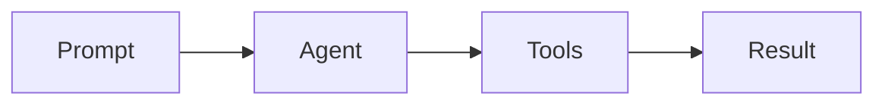

# Markdown diagram previews

Render Mermaid diagrams inline in Neovim's agent session logs and Markdown file
buffers, including report files and floating Markdown previews. Source remains
visible and editable; diagrams use virtual padding rather than changing the file
or saved conversation.

[Back to README](../README.md)

## Kitty setup with vim.pack

Install ImageMagick and Mermaid CLI:

```sh
brew install imagemagick
npm install -g @mermaid-js/mermaid-cli
```

Mermaid CLI uses a headless browser to generate PNGs. Follow its installation
instructions if your environment requires a custom Chromium/Puppeteer setup.

Load and configure `image.nvim` before Aero:

```lua
vim.pack.add({ "https://github.com/3rd/image.nvim" })

require("image").setup({
  backend = "kitty",
  processor = "magick_cli",
  integrations = {
    markdown = {
      enabled = true,
      floating_windows = true,
      download_remote_images = false,
    },
  },
  max_height_window_percentage = 50,
})

require("aero").setup({
  acp = { image_previews = true }, -- screenshots and other ACP images
  mermaid = { enabled = true },   -- diagrams in all Markdown buffers
})
```

Mermaid previews use image.nvim's file API directly, so they do not require
Tree-sitter parsers. Its regular Markdown image-link integration requires the
`markdown` and `markdown_inline` parsers, as described in
[inline image previews](agents.md#inline-image-previews-in-kitty).

## Diagram syntax

Open a Markdown file containing:

````markdown

````

The same fenced block in an agent message is previewed automatically. Complete
backtick and tilde fences are supported; incomplete streamed diagrams wait for
their closing fence. A single diagram wrapped in a `markdown` or `md` code block
also gets a preview, as agents often use this format when showing Markdown syntax.
Wrappers containing additional prose or multiple diagrams stay as source examples.

Previews update after edits, use a separate image for each visible window, and
follow scrolling and window resizing through image.nvim. Diagram generation is
asynchronous with at most four CLI processes running at once (configurable with
`concurrency`). Aero also pre-renders the next two diagrams below the viewport;
set `prefetch = 0` to disable this. Pending previews show an animated status line
below the last source line, including their diagram number, queue position or
rendering state, and elapsed time. The animation does not rerender existing images.
PNGs are cached in
`stdpath("cache")/aero/mermaid` by source and rendering settings. Missing
dependencies and invalid diagrams show an inline status near the end of the block;
the original source remains available.

Previews work alongside `render-markdown.nvim`, including its concealed code
delimiters. Padding is anchored to the final source line rather than the closing
fence, so hiding the delimiter does not let the image overlap subsequent text.

## Expand a diagram

Each ready diagram has a clickable **Expand diagram · gM** control at the right
edge of its last source line, just above the image. Click it, or put the cursor
inside the diagram's fenced block and press `gM`, to open a large floating viewer.
The same control works in agent transcripts and Markdown files.

In the viewer:

- Click **Fullscreen**, or press `f` / `gF`, to switch between floating and
  fullscreen sizes. Fullscreen uses nearly the entire editor.
- Click **Close**, or press `q` / Escape, to return to the source window.
- Resizing Neovim resizes the viewer and scales the diagram to fit.

The expanded viewer ignores inline image size limits and uses the cached PNG.
Inline Mermaid images are temporarily hidden while the viewer is open, preventing
Kitty graphics from showing through its floating window. Opening the same diagram
again toggles the viewer closed. Controls and shortcuts never modify source text.

## Options

```lua
require("aero").setup({
  mermaid = {
    enabled = true,
    cmd = { "mmdc" }, -- executable plus optional CLI arguments
    theme = "auto", -- follow 'background'; or default, dark, forest, neutral
    background = "transparent",
    scale = 2,
    concurrency = 4, -- simultaneous CLI processes; lower this to reduce browser memory use
    prefetch = 2, -- diagrams ahead of the viewport; 0 disables prefetching
    max_width = 80, -- terminal columns
    max_height = 24, -- terminal rows
    preview_key = "gM", -- false disables the keyboard shortcut; the button remains
  },
})
```

For a custom browser configuration, include Mermaid CLI's `-p` argument in `cmd`,
for example `{ "mmdc", "-p", "/absolute/path/puppeteer.json" }`.
Set `mermaid.enabled = false` and rerun Aero's setup to disable previews and clear
their images. Markdown files and exported logs always retain their Mermaid source.

The automatic theme keeps connecting lines and labels readable on light and dark
terminal backgrounds. Changing Neovim's `background` option refreshes diagrams.

## Images missing inside tmux

If diagrams compile but only source text appears, check whether Neovim runs inside
tmux (`:echo $TMUX`). Kitty graphics need tmux passthrough. Add to your tmux config:

```tmux
set -g allow-passthrough on
set -g focus-events on
set -g visual-activity off
```

Apply these options to the running server or reload your tmux config, then restart
Neovim so image.nvim refreshes its cached tmux capability detection. Check the live
setting with `tmux show-options -g allow-passthrough`; it should report `on`.

Aero's web companion already renders Mermaid separately in its transcript and
Markdown previews; these Neovim settings control terminal previews.
